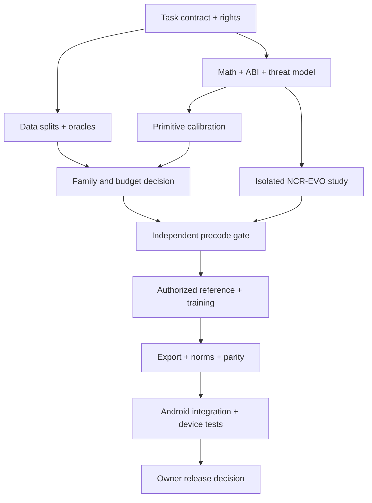

# ASTRA 07 — D01–D10: предкодовый инженерный контракт

Здесь приняты конкретные проектные решения, а не поручение разработчику выбрать архитектуру наугад. Data-dependent artifacts и hardware coefficients имеют определённый способ получения; они ещё не существуют. `SPECIFIED` означает готовый контракт, **не** выполненный release gate. Все candidate thresholds ниже требуют утверждения до испытаний; до того production не допускается.

## D01. Каталог полноценных задач и качество

Единица оценки — **выданная владельцем задача**, включая refusal/timeout/clarification, а не только выполненная команда. Task manifest хранит input sequence, allowed scope, independent expected predicate/answer rubric, max length, oracle, risk class, split group, severity и resource envelope. Все функции организма обязательны в architecture; research variants не удаляются ради small benchmark.

|Стратум|Граница сценария и oracle|Candidate acceptance (не результат)|
|---|---|---|
|RU text/dialogue|≤4096input/4096outputtokens; contextual answers, уточнение двусмысленного intent; blinded rubric|LCB task correctness≥.85, coverage≥.9|
|RU voice|≤10s utterance, accents/noise/near/farfield; independent transcript|WER≤.15 clean,.30 noisy; command semantic accuracyLCB≥.90|
|Grounded screen|≤256patches +nativeUIversion; bbox/element/reading labels|LCB grounding≥.90; unknown surfaces correctly abstain|
|Planning|≤16typedsteps, interruptions, changed prerequisites|LCB full-goal success≥.80; partial completion explicit|
|Native controls|catalog05 and independent endpoint|LCB correct verified effect≥.95 for supported observable subset|
|Local information|notes/documents/answers with permitted local sources|LCB source-grounded answer≥.90; no fabricated cited record|
|TTS RU|≤256tokens/chunk,10s waveform; independent listeners|word intelligibilityLCB≥.95, MOS≥3.5 with listener uncertainty; RTF≤1|
|Memory|query after32/256/1024/4096events; expiry/contradiction|retrievalLCB≥.90 per horizon; no reuse deleted source|
|Plasticity|paired novel/old tasks, verified feedback|newΔLCB≥.02,oldΔLCB≥−.01; unknown doesnottrainP|
|Uncertainty|ambiguous intent, unsupported language/app/readback|false-successUCB≤10^-4, coverage reported perclass|
|Lifecycle/security|STOP/revoke/reboot/processdeath/replay/storagefull|all exact logical fixtures pass; field risk evaluated separately|
|Resources/offline|issued task battery,1h/24h idle,thermalsoak,airplane mode|caps05, zero unexpected external network dependencies|

These q_j proposals define a falsifiable target; math doesnotchoose owner utility. ASR WER unbounded if manyinsertions; reportmean withcluster bootstrapor explicitclip forbounded test (clippedWERmustbenamed). MOS/inter-rater variance notbinomial. Safety error rate Bernoulli perissuedtask: with0failures, one-sided95% upperbound=1−.05^(1/n); to≤10^-4 requiresn≥29956independenttasks. Withmultiple strata adjustα;29,956doesnotcertifyallcells. For bounded accuracy ±.02 at95%,Hoeffdingn4612foronefixedpolicy; notrequiredtrainingdataset size. Statisticalunitgroupedbysession/user, notaudioframes.

## D02. ABI и численные форматы

`UNO_MODEL_ABI/2` normative architecture W2/S4–S7; nohidden tensors. Files: `architecture.json`, `tensor_manifest.json`, `weights.bin`, `tokenizer.json`, `dsp.json`, `schemas.json`, `norm_certificate.json`, `parity_report.json`, `model_signature.json`. Theyarefuture artifact names, notclaimfilesalreadybuilt. Current complete shapeinventory provided in evidence.

Canonical JSON: UTF-8,keyslexicallysorted,noduplicates,noNaN/Inf,integersdecimal,floatfieldsasIEEEhexstringswhenhash-sensitive; digestSHA256overexactcanonicalbytes. Arraysfinitecappedbeforeparse. Binarylittle-endian, alloffsetsuint64, overflowchecked, tensorsnonoverlapping, maxfilesize frommanifest. Unrecognized majorversiondenied; minorversioncannotaltermathorpermissions. Weightsheadercontainsmagic`UNOWGT02`,endianflag,version,d,nb,V,A,m,J,χ,tensorcount,descriptoroffset,databytes,manifestdigest; unusedheaderbyteszero. Each128bytedescriptorcontainsname-id,rank≤4,shape4×u32,type,offset,length,scaleblockoffset,length,rawSHA256,normcertificateindex; точные offsets заданы ниже; native C-struct padding не используется. Normcertificate recordsdecoded row sums/max, quant scale rounding, backend accumulatorbounds.

`ObservationEnvelope/2`: tagu16,flagsu16,payloadlengthu32,sessionnonce128,sequenceu64,monotonicnsu64,sourceenumu16,sourcegenerationu32,modeldigest32,payloadref(slot,generation,hash). Totalfixedheader128bytes padded0. Sourceauthenticationiscontroller-ownedhandle, nothashalone. `Proposal/2`: verbu16,canonicalargs≤4096bytes,goalId,parentId,epoch,nonce,modeldigest,preconditionversion,expected-schema-id,deadline,traceRef,digest. IPCmax64KiB permessage; arraysreferencesnotunboundedBinderpayload. Proposal≥128tokens limitstillapplies.

`Trace/2`: h_issue[d]FP32,modeldigest,canonicalproposalhash,goal,ν/e,issuedtime,q_issue,Pversion,RNGcounter,deadline,expected/prestatepayloadrefs;256bytefixedmetadata. `Evidence/2`: ticket,endpoint-sampletime,query-start/end,nativesourceversion,taskEvidence,attribution,censorReason,pre/postrefs,validatorversion; protectedcontroller record. `PState/2`: AdFP32,rowL2cert,version,modeldigest,used-ledger-commitid. `MState/2` exactheader04. `Ledger/2`:128byteheader+payloadref, statusPREPARED/SENT/MAY_HAVE_EXECUTED/COMMITTED/CANCELLED,immutablehistorydigest; fullargs/receiptsseparatepayload. CanonicalgoalDSL arrays≤16clauses and16steps, Q≤64.

ABI lacks **no mathematical choice** but two data-dependent payloads necessarily pending: vocabularymerges/trainnormalizers and backendpackedlayout. Reference ABI isfixedrow-major64alignment02. Backendpack isderivative cache keyedbybackendversion+modeldigest, discardable, cannotredefineweights. Ifbackendrequiresunknown operators/hiddenpackingworkspace, failcalibration, notsilentchange.

## D03. Data/training BOM

Data manifests/rights/transforms/splits03; trainingconfig includesalllossesandλ,optimizersteps,seed,precision,unroll,CTCalphabet,mixture,eventcounts,compute cap,retentionbattery. Stageinputs→outputs: licensedraw→canonicalexamples→split/tokenizer/normalizer→jointΘFP32→QATexport→normcertificate+test. Eachcheckpointstoresoptimizerstate,RNG,datacursor,graph/dataset/toolchainhashes. Reproducingweightsrequiresalltrainingdataanddeterministicbackendor declared numeric tolerance, notjustseed.

Minimum viable trainingbudget isnotidentifiable beforelearningcurve. Contract isclosed: noGPUchoiceguess; applyL6/L7tomeasuredr_effective,VRAM,licensedN_e; chooseA/B/C03orreturnEMPTY_FEASIBLE_SET. Fromscratchdefault; teachersnotmandatory. Noofflineexperimentclaimwithoutactualweights/logs.

## D04. Memory/state BOM

M/P/L separation04; capsandpayloadindex05; activegoalvectoronlyone, savedworkstatecountedinworkspace. Versionmigrationlazy16entriesperbudget, nooldquery/keymixing. Coldreset: newν,STOP,authenticateΘ,s=g=P=0,emptyactivecache,quarantineM. Warmresetwithinprocess stillnewν,STOP,pendinginvalidate; preservevalidatedP/Monlysamev. P persistence transactional withreceipt, notworker-ownedfile. Reconciliationlogpersiststhroughbothresets; nonidempotentUNKNOWNblocksautoresume.

## D05. Controller/backend design

Controllerusesbounded singlewriter transactionqueue; trustedOSqueriesasynchronous; nonce/epoch/consentcheckedatdispatchandcommit; exactcapabilitymatrix05. SQLite-style transactional local store chosen asimplementationcandidate with WAL8MiB cap+authenticatedsnapshots; toolchain/OSfault-injectionmustestablishA_tx/A_fs. Secretkeyscontroller-onlyKeystore, modelpublisherpublickeypinned; nosecretinreports. P128generationprobabilistic; hardwareanti-rollbackCOUNTERnotassumed. Threadaffinity: UIthreadonlyUI/consent; controllerprioritythreadcontrol; workercompute1activejob;DSPinworker; allqueuesbounded. No new autonomous agent/servicepermodality.

## D06. Multimodal schedule

PCM16/FFT512/hop160/mel80, causalpadding,CTC,sharedF,TTSfeedbackGLall05. CaptureandTTSbounded10s;halfduplex;UIeventsqueueorcancelneuralturn. Screenresize256²meanssmalltextmaybelost; qualitygateincludesfonts/scales. Fallbacktilingmorethan256patchesrequiresmultipleexplicitobservations andproportionalcost, notfreehighresolution. ColorRGBuint8×(2/255)−1, letterbox0ininputspace, patchorderrow-major;normalizationdspdigest includesallconventions. SensorchannelsdeclareSIunit,min,max,missingmask;unavailablechannelszero+mask0. Inferenceattemptwithdifferentnormalizerrejectsmanifest.

## D07. Hardware and material feasibility

TargetfirstA52Android14; exactSKU/RAM/SoC/ABI/buildfingerprint notininputevidence. CPUarm64referencechosen;nativeblockedmatvecwithoutdenserecomputeformaskedrows. GPU/NNAPI optional onlyifsupports exactneededopsandisolation, measuredbenefit/PSS; notassumedavailable. Primitivecalibration05beforecommitmenttomodelsize. Candidatebudgets512MiBPSS/etc05,externalpowercoefficientsunknown. Traininghardwareunknownseparately. Memorybandwidth,thermalthrottling,queuebackpressurecanrejectevenmodelwhoseweightfilefits. Devicefailchangespaperfamilyselection, notfeaturedeletion.

## D08. NCR-EVO

CompleteDSL/sampling/archive/repair/power/accounting06. Runonisolatedlabdevice/PC, noAPKpermissions orrepositorycredentials. Θ/θ/φseparate, promotionartifact-only. BaseUNOdoesnotdependonNCRsuperiority: labclaimM41remainstestablebutunproved. EvaluationA/B/C/Dincludesfitcostandpreservesnegativeresults.

## D09. Dependency DAG and toolchain lock

F→G is **closed now**. CalibrationD islimitedprimitivesafterseparateauthorization, notproductionkernel. NCR-EVO notdependencyfor ordinary G unless promotingmutation.

Futurelocalbuildcandidate: JDK17,AGP8.9.2,Gradle8.11.1,compileSDK35/buildtools35.0.0,NDK27.0.12077973,arm64-v8a, minSDK34,targetSDK34 forrestrictedA52engineeringfixture. OfficialAGP8.9compatibilitytableverified02.11.2026: https://developer.android.com/build/releases/agp-8-9-0-release-notes. This deliberatelyfrozenfixtureisnotclaimofcurrentcommercialstoreeligibility; release target/API policyrecheckedbeforeG6. Java17controlleravoidsunspecifiedKotlinplugin;nativeC++17fixedABI. Traininglibrary/backendexactversionisnotpinnedwithoutchoosingavailablehardware; lockproceduremustrecordpackageversion+wheel/sourcehash+compiler+BLAS+driverandlicense, thenrerunnumericparity. MissinghashesareBLOCKED artifactinputs, notmade-updigests.

BuildBOM: mathreference,training,exporter,nativeworker,controller,UI/resources,testoracles,DSP,SQLiteprovider,crypto/AndroidOS,modelpackage. Perdependencyrecordname/version/sourceSHA/license/notice/runtime-networkcapability. ClosedUNOsourcepolicydoesnotrelicenseborroweddata/code. No oldJarviscomponent imported;iflaterproposed requiresindependentprovenanceandlicensecheck. OfflineAPKhasnoINTERNETpermission,noremotemodeldownload,analyticsorOAuth; external document providerbehavior labelledoutsideUNOcontrolledprocess. Deviceairplanemode+networkauditmustconfirmdependentSDKsnotfallbackonline.

Buildstorage bound B_tools+B_dependencycache+B_data+B_checkpoints+B_intermediates+B_artifacts; localdiskheadroom≥maxsimultaneousversions+20%candidate reserve. Buildtime t_compile+t_package+t_test measured; nohonestnumericestimatewithoutsources/toolchain. Signingkeysoutofrepo;releaseSBOMandmodellicensebundle mandatory. Reproducibilityrequiresdoublecleanlocalbuildfromsameinputs,compareunsignedpayloadhashes;signaturetimestampnondeterminismseparatelydocumented. NoGitHubActions.

## D10. Operational risks and release stops

|Risk|Prevention/detection|Mitigation / gate|
|---|---|---|
|wrong Russian intent/ASR|exact typed confirmation, held-out semantic tests|clarify; no permission inferredfromvoice alone|
|prompt injection in screen/document|source-role separation, controllercapabilityscope|untrustedtext cannotcreateownerconsent|
|forged/stale receipt|nativehandles,session/epoch/digest,atomicused|reject, quarantine, STOP iftrustbroken|
|processdeath/partialOS effect|durable PREPARED+reconciliation|UNKNOWN, no nonidempotent autoretry|
|corrupt/rollbackmemory|authenticity+newν; schema/norm checks|baseline reset; freshnesslimitsP128explicit|
|quality collapse afterP/Θ|prequentialscores,pairedretentionstrata|disableP/newversionrollbackwithnewν|
|resource starvation/thermal|admission+caps+actualtelemetry|abstain/suspendcapture; recordcoveragefailure|
|data/voicelicense orprivacy revoke|manifestrights,consent,keyseparation|quarantine/deletionbyexplicitownerpolicy;retrainingimpactdocumented|
|quantizednorm/parityfailure|actualdequantcertificate+margincheck|rejectexport; FP16candidateonlyiffits|
|oracle exploit / badNCR|immutableindependentevaluator,secretfreshholdout|STOPstudy, noautopromotion|
|platform API unsupported|perverb deviceprobe/currentpermissions|DENIED/UNKNOWN, neverclaimsuccess|

Release stopconditions: anyunauthorizeddispatch, replaylearning, leakedprivatepayload, unexpectednetworkdependency,orunresolvedcriticalauditfinding→FAIL. Statisticalriskupperboundabovebudget,qualitylowerboundbelowtarget,deviceovercap→NO_RELEASE. No automatic trialonuser’srealdata. Rolloutmanualowner-selectedlocalbuild;previousverifiedsignedmodelretainedforrollback,newνonactivation. Supportcost model C_support=N_devices·incident_rate·mean_resolution_hours·hour_cost+device_matrix_retest_cost+data/license_refresh_cost; everycoefficientunknown,recordpilotincidentsbeforecommercialcostclaim.

## D01–D10 completion verdict

Alltensectionsnowhave concretearchitecture/contracts,dependencies,observablesandclosuremethod. Their **specification** is delivered; G2 productionengineeringreadinessremainsBLOCKED byapprovedtaskthresholds,licenseddata,hardwarecoefficients,backend/toolchainhashesandA52trust/APItests. Theseareexplicitmeasurableinputs, notworkdelegatedbackas“inventarchitecture”. Exactunknownstable12 andexecutionblueprint11 define nextauthorizedoperations.

## Нормативные byte offsets ABI/2

Weights header (4096 bytes): magic8@0; major u16@8; endian u16@10 (1=LE); d u32@12; nb@16; V@20; A@24; m@28; J@32; chi@36; tensorCount@40; reserved u32@44; descriptorOffset u64@48 (=4096); dataOffset u64@56; fileBytes u64@64; canonicalManifestSHA256[32]@72; остальные bytes zero. Все offsets от начала файла.

Descriptor (128 bytes): tensorId u32@0; rank u16@4; dtype u16@6 (1=FP32,2=FP16,3=INT8); shape u32[4]@8; byteStrides u32[4]@24; dataOffset u64@40; dataLength u64@48; scaleOffset u64@56; scaleLength u64@64; dataSHA256[32]@72; normCertificateIndex u32@104; flags u32@108; reserved zero[16]@112. Matrix row stride для INT8 roundUp(columns,16), element stride1; scale FP32. Shape unused dimensions0. Векторы FP32 contiguous, start aligned64. e_modality хранится FP32 как 6×d, независимо от наличия 2dimensions.

Observation header128: tag u16@0; flags u16@2; payloadLength u32@4; sessionNonce[16]@8; sequence u64@24; monotonicNs u64@32; sourceEnum u16@40; reserved u16@42; sourceGeneration u32@44; modelDigest[32]@48; payloadSlot u32@80; payloadGeneration u32@84; payloadSHA256[32]@88; reserved zero[8]@120.

Trace metadata256: nonce[16]@0,e u64@16,serial u64@24,modelDigest[32]@32,proposalDigest[32]@64,goalId u64@96,issuedNs u64@104,deadlineNs u64@112,Pversion u64@120,qY FP32@128,qR@132,risk@136,conf@140,PRNGseed[16]@144,PRNGcounter u64@160,expectedSlot u32@168,expectedGeneration u32@172,expectedHash[32]@176,prestateSlot u32@208,prestateGeneration u32@212,prestateHash[32]@216,validatorVersion u32@248,flags u32@252. Затем отдельный aligned h_issue[d] FP32. Ни expected predicate, ни prestate не помещаются неявно в 256bytes: они находятся в оплачиваемом payload store.

L header128: ticketDigest[32]@0,payloadSlot u32@32,payloadGeneration u32@36,payloadHash[32]@40,transactionId u64@72,timestamp u64@80,status u32@88,flags u32@92,sourceGeneration u64@96,epoch u64@104,serial u64@112,reserved zero[8]@120. Full nonce/digests/prestate сохраняются в associated protected payload; header identity digest не заменяет active ticket guards.

PRNG вычислительной политики: counter-based SHA-256 stream, seed128 + counter64LE + domain-tag32bytes; блок SHA256 трактуется как 256-bit unsigned big-endian integer U, uniform u=(U+.5)/2^256. Для categorical — первый cumulative probability строго больше u; последнему элементу остаток округления. Counter overflow→new work seed with explicit logged restart или отказ; не silently wrap. SHA здесь определяет воспроизводимый поток для модели, не абсолютную независимость математических draws: статистические theorem предполагают IID random seeds/draws, implementation approximation должна быть названа. Authority nonce всегда separate OS CSPRNG и не извлекается из этого stream.
