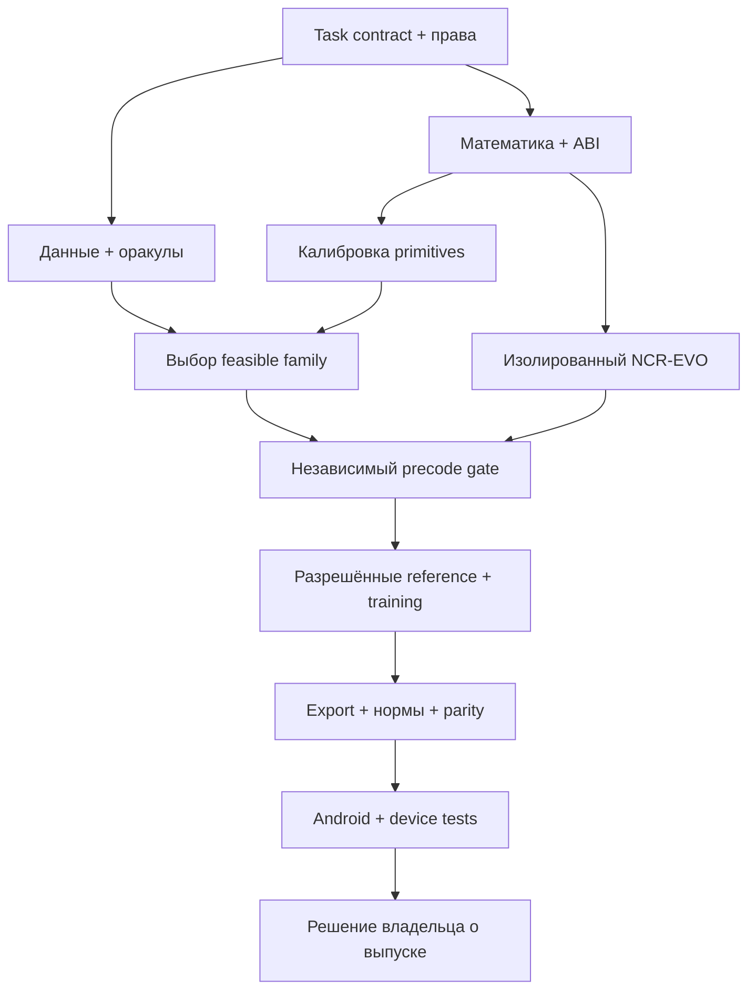

# ASTRA 07 — D01–D10: предкодовый инженерный контракт

Здесь приняты конкретные проектные решения, а не поручение разработчику выбрать архитектуру наугад. Data-dependent artifacts и hardware coefficients имеют определённый способ получения; они ещё не существуют. `SPECIFIED` означает готовый контракт, **не** выполненный release gate. Все candidate thresholds ниже требуют утверждения до испытаний; до того production не допускается.

## D01. Каталог полноценных задач и качество

Единица оценки — **выданная владельцем задача**, включая refusal/timeout/clarification, а не только выполненная команда. Task manifest хранит input sequence, allowed scope, independent expected predicate/answer rubric, max length, oracle, risk class, split group, severity и resource envelope. Все функции организма обязательны в architecture; research variants не удаляются ради small benchmark.

|Стратум|Граница сценария и oracle|Candidate acceptance (не результат)|
|---|---|---|
|RU text/dialogue|≤4096input/4096output tokens; contextual answers, уточнение двусмысленного intent; blinded rubric|LCB task correctness≥.85, coverage≥.9|
|RU voice|≤10s utterance, accents/noise/near/farfield; independent transcript|WER≤.15 clean,.30 noisy; command semantic accuracyLCB≥.90|
|Grounded screen|≤256patches +nativeUIversion; bbox/element/reading labels|LCB grounding≥.90; unknown surfaces correctly abstain|
|Planning|≤16typedsteps, interruptions, changed prerequisites|LCB full-goal success≥.80; partial completion explicit|
|Native controls|catalog05 and independent endpoint|LCB correct verified effect≥.95 for supported observable subset|
|Local information|notes/documents/answers with permitted local sources|LCB source-grounded answer≥.90; no fabricated cited record|
|TTS RU|≤256tokens/chunk,10s waveform; independent listeners|word intelligibilityLCB≥.95, MOS≥3.5 with listener uncertainty; RTF≤1|
|Memory|query after32/256/1024/4096events; expiry/contradiction|retrievalLCB≥.90 per horizon; no reuse deleted source|
|Plasticity|paired novel/old tasks, verified feedback|newΔLCB≥.02,oldΔLCB≥−.01; unknown doesnottrainP|
|Uncertainty|ambiguous intent, unsupported language/app/readback|false-successUCB≤10^-4, coverage reported perclass|
|Lifecycle/security|STOP/revoke/reboot/processdeath/replay/storagefull|all exact logical fixtures pass; field risk evaluated separately|
|Resources/offline|issued task battery,1h/24h idle,thermalsoak,airplane mode|caps05, zero unexpected external network dependencies|

Для каждого task stratum candidate coverage floor c_j=.9, если manifest заранее не повышает его. Корректный отказ/уточнение считается завершением только согласно независимой разметке задачи; качество оценивается отдельно. Coverage constraints в03 условны по классу, а не по смеси. These q_j proposals define a falsifiable target; math doesnotchoose owner utility. ASR WER unbounded if manyinsertions; reportmean withcluster bootstrapor explicit clip forbounded test (clipped WER must be named). MOS/inter-rater variance notbinomial. Safety error rate Bernoulli perissuedtask: with0failures, one-sided95% upperbound=1−.05^(1/n); to≤10^-4 requiresn≥29956independenttasks. Withmultiple strata adjustα;29,956doesnotcertifyallcells. For bounded accuracy ±.02 at95%,Hoeffdingn4612foronefixedpolicy; not required training dataset size. Statistical unit grouped by session/user, not audio frames.

## D02. Каноническая модель и ABI

Нормативная архитектура — UNO_MODEL_ABI/2, формулы W2/S4–S7. Полный набор будущих артефактов: architecture.json, tensor_manifest.json, weights.bin, tokenizer.json, dsp.json, schemas.json, norm_certificate.json, parity_report.json, model_signature.json. Это названия требуемых файлов, а не утверждение, что веса уже построены. Текущий shape manifest находится в evidence.

Canonical JSON: UTF-8, лексикографический порядок ключей, без duplicate keys/NaN/Inf; integers decimal, hash-sensitive float fields — IEEE hex strings. SHA256 считается по точным canonical bytes. Длины массивов проверяются до выделения памяти. Binary little-endian, offsets uint64 с проверкой overflow; tensor ranges не пересекаются. Неизвестная major version отклоняется; minor version не меняет математику или полномочия. Точные offsets приведены ниже, native C-struct padding не используется.

Proposal/2: verb u16, canonical args≤4096bytes и 128tokens, goal/parent id, ν/e, model digest, precondition version, expected-schema id, deadline, trace ref, proposal digest. IPC≤64KiB/message, длинные данные только через bounded refs. Evidence/2 содержит ticket, sample/query timestamps, native source generation, task Evidence, attribution, censor reason, pre/post refs, validator version. Это protected controller record, не текст worker.

PState/2: Ad FP32, row-L2 certificate, version, model digest, ledger commit id. MState/2 — точный header04. Ledger/2 хранит PREPARED/SENT/MAY_HAVE_EXECUTED/COMMITTED/CANCELLED; полные args/receipt отдельно в payload store. Goal DSL≤16clauses, plan≤16steps, Q≤64.

Две части артефакта зависят от будущих данных: tokenizer merges и audio normalizers. Их алгоритм получения уже задан 03. Backend packing — производный discardable cache, keyed by backend version/model digest; он не меняет Θ. Если backend требует незаданных operators/workspaces, calibration gate отклоняет его. Нормативный reference layout — row-major/alignment02.

## D03. Данные и обучение

03 задаёт source rights, transformations, immutable grouped splits, все losses, optimizer, seeds, precision, unroll, CTC alphabet, mixtures, compute caps и retention battery. Цепочка: licensed raw → canonical examples → splits/tokenizer/normalizers → joint Θ FP32 → QAT export → norm certificate + independent test.

Checkpoint включает optimizer/RNG/data cursor и hashes графа, dataset, toolchain. Seed без данных и backend недостаточен для воспроизводимости. Training budget определяется L6/L7 и измеренными effective FLOP/s/VRAM. Если ни один сценарий A/B/C не помещается, результат EMPTY_FEASIBLE_SET. From-scratch — default; внешний teacher не обязателен. Без весов/логов нельзя утверждать проведённое обучение.

## D04. Память и перенос состояния

M/P/L разделены 04; payload index/FP32trace/COW учитываются 05. Active goal vector один; saved work state входит в workspace. Lazy migration≤16entries на доступный task budget, старые keys исключены из query до пересчёта. Cold reset: freshν,STOP, authenticateΘ, s=g=P=0, active caches пусты, M quarantine. Warm reset также создаёт freshν и STOP; сохранить P/M можно лишь после проверки совместимости v. Pending tickets не возрождаются, reconciliation log сохраняется. Nonidempotent UNKNOWN запрещает autoresume.

## D05. Доверенный контроллер

Один controller writer обслуживает bounded transaction queue; OS queries asynchronous. ν/e/consent проверяются на dispatch и commit. Capability table05 — единственный privilege entry point. SQLite-style transactional store с WAL≤8MiB и authenticated snapshots — выбранный backend-кандидат; fault injection должен подтвердить A_tx/A_fs на целевом окружении.

Keys доступны только controller через Keystore; public key модели pinned. P128 — вероятностный профиль, аппаратный antirollback не предполагается. UI thread обслуживает только UI/consent; отдельный controller thread — STOP/gate/transactions; один worker — neural compute и DSP. Очереди ограничены. Это не отдельный интеллектуальный агент на каждую modality.

## D06. Мультимодальное исполнение

PCM16/FFT512/hop160/mel80, causal padding, CTC и TTS feedback/GL определены 05. Capture/TTS≤10s, полудуплекс. UI observations ждут neural turn либо явно отменяют его. Resize screen до 256² может потерять мелкий текст; тест включает разные шрифты/масштабы. Tiling сверх 256patches — дополнительные наблюдения с полной ценой, не бесплатное повышение разрешения.

RGB uint8 нормируется 2x/255−1; letterbox имеет 0 в нормированном пространстве; patch order row-major. Position/letterbox rectangle в metadata задаёт применимость patches. Sensor channels имеют SI units/ranges/missing masks; недоступный канал 0 с mask0. Другой tokenizer/normalizer означает другую model version и не смешивается молча.

## D07. Аппаратная выполнимость

Первое устройство A52/Android14; exact SKU/RAM/SoC/build fingerprint не установлены. Reference — arm64 CPU и kernels, действительно пропускающие неактивные блоки. GPU/NNAPI допустимы только после проверки operators, numeric parity, isolation и полной цены. Их наличие/ускорение не предполагается.

Primitive calibration05 предшествует фиксации production size. Candidate caps512MiB и прочие 05 не являются измерениями. Memory bandwidth, heat, queue overload могут отвергнуть модель, даже если файл весов помещается. Тогда меняется family/schedule по 02, а не удаляются обязательные функции.

## D08. NCR-EVO

06 задаёт DSL, mutation, surrogate, propensities, archive, repair, independent testing и full costs. Лаборатория не получает APK permissions или repository credentials. Θ/θ/φ различны. Promotion — отдельный reviewable artifact. Base UNO не зависит от доказательства superiority NCR; M41 остаётся открытым экспериментом.

## D09. Граф сборки и зависимости

Переход F→G сейчас закрыт. D — только разрешённая калибровка primitives, не production kernel. NCR не обязателен для обычного runtime, но его promoted mutation возвращается на review.

Будущий local engineering fixture: JDK17, AGP8.9.2, Gradle8.11.1, compileSDK35/buildtools35.0.0, NDK27.0.12077973, arm64-v8a, minSDK34,targetSDK34. Совместимость AGP8.9 проверена по официальной таблице: https://developer.android.com/build/releases/agp-8-9-0-release-notes. Это frozen A52 fixture, не утверждение о текущих требованиях коммерческого store; release API policy проверяется передG6. Controller Java17, native C++17; отдельный Kotlin plugin не предполагается.

Training library/backend version фиксируется после выбора фактически доступного оборудования: version + source/wheel SHA + compiler + BLAS + driver + license, затем parity. Неизвестные package hashes — BLOCKED inputs, а не выдуманные digests. Build BOM: reference, trainer, exporter, native worker, controller, UI, DSP, storage, crypto/OS, test oracles, model package. Для каждого dependency — name/version/sourceSHA/license/notice/network capability. Старые Jarvis components не импортированы.

Offline APK не имеет INTERNET permission, remote model downloader, analytics или OAuth. Поведение внешнего document provider маркируется отдельно; зависимые SDK проверяются в airplane mode и network audit. Build storage = tools + caches + data + checkpoints + intermediates + artifacts, с 20%candidate reserve. Build time измеряется на фактических sources/toolchain; формула не выдаёт готового числа. Signing keys вне репозитория; SBOM/licenses обязательны. Две чистые local builds должны давать одинаковые unsigned payload hashes; signature/timestamp differences описываются отдельно. Git Hub Actions не использовать.

## D10. Эксплуатационные риски

|Риск|Предотвращение / выявление|Закрывающий результат|
|---|---|---|
|Ошибка RU intent/ASR|typed confirmation, semantic holdout|clarify; голос сам по себе не consent|
|Injection из screen/document|source-role separation, fixed capability envelope|untrusted content не создаёт owner authority|
|Forged/stale receipt|native handles,ν/e/digest,atomicused|reject/quarantine; STOP при нарушении trust|
|Process death/partial effect|durable PREPARED/reconciliation|UNKNOWN; нет silent nonidempotent retry|
|Corrupt/rollback memory|authentication,freshν,schema/norms|baseline reset; пределы P128 явны|
|Forgetting/quality collapse|prequential/paired retention tests|disableP или approved version rollback с newν|
|Overload/thermal|admission,actual telemetry,quotas|abstain/suspend; coverage failure в отчёте|
|License/privacy violation|rights manifest,consent,key isolation|quarantine и owner-controlled privacy procedure|
|INT8 mismatch|decoded norms + error bounds|reject export; FP16 только если feasible|
|NCR oracle exploit|immutable evaluator,fresh holdout|STOP study, noautopromotion|
|Unsupported API|device probes,current permissions|DENIED/UNKNOWN, не success|

Любой unauthorized dispatch, replay learning, private-data leak, unexpected network dependency или unresolved critical audit issue даёт FAIL. Quality lower bound ниже target, risk upper bound выше cap или device overbudget запрещают release. Rollout только вручную выбранной локальной сборкой; предыдущая подписанная версия сохраняется, любая активация создаёт newν.

Support cost = N_devices × incident_rate × mean_resolution_hours × hourly_cost + device_matrix_retest_cost + license/data_refresh_cost. Коэффициенты неизвестны; pilot incident evidence нужен до commercial cost claim. Это экономическая формула, не прогноз дохода.

## Статус D01–D10

Десять инженерных областей теперь имеют конкретные контракты, зависимости, наблюдаемые ошибки и способы закрытия. Спецификация доставлена; production engineering gateG2 остаётся BLOCKED из-за отсутствующих approved thresholds, licensed data, hardware coefficients, package hashes и device trust/API evidence. Разработчику не передаётся задача изобрести архитектуру: missing input означает BLOCKED по 12, следующий разрешённый шаг указан 11.

## Нормативные byte offsets ABI/2

Weights header (4096 bytes): magic8@0; major u16@8; endian u16@10 (1=LE); d u32@12; nb@16; V@20; A@24; m@28; J@32; chi@36; tensorCount@40; reserved u32@44; descriptorOffset u64@48 (=4096); dataOffset u64@56; fileBytes u64@64; canonical ManifestSHA256[32]@72; остальные bytes zero. Все offsets от начала файла.

Descriptor (128 bytes): tensor Id u32@0; rank u16@4; dtype u16@6 (1=FP32,2=FP16,3=INT8); shape u32[4]@8; byteStrides u32[4]@24; dataOffset u64@40; dataLength u64@48; scaleOffset u64@56; scaleLength u64@64; dataSHA256[32]@72; norm Certificate Index u32@104; flags u32@108; reserved zero[16]@112. Matrix row stride для INT8 round Up(columns,16), element stride1; scale FP32. Shape unused dimensions0. Векторы FP32 contiguous, start aligned64. e_modality хранится FP32 как 6×d, независимо от наличия 2dimensions.

Observation header128: tag u16@0; flags u16@2; payload Length u32@4; session Nonce[16]@8; sequence u64@24; monotonic Ns u64@32; source Enum u16@40; reserved u16@42; sourceGeneration u32@44; modelDigest[32]@48; payload Slot u32@80; payloadGeneration u32@84; payloadSHA256[32]@88; reserved zero[8]@120.

Trace metadata256: nonce[16]@0,e u64@16,serial u64@24,modelDigest[32]@32,proposalDigest[32]@64,goalId u64@96,issued Ns u64@104,deadline Ns u64@112,Pversion u64@120,qY FP32@128,qR@132,risk@136,conf@140,PRNGseed[16]@144,PRNGcounter u64@160,expected Slot u32@168,expected Generation u32@172,expected Hash[32]@176,prestate Slot u32@208,prestate Generation u32@212,prestate Hash[32]@216,validator Version u32@248,flags u32@252. Затем отдельный aligned h_issue[d] FP32. Ни expected predicate, ни prestate не помещаются неявно в 256bytes: они находятся в оплачиваемом payload store.

L header128: ticket Digest[32]@0,payload Slot u32@32,payloadGeneration u32@36,payload Hash[32]@40,transaction Id u64@72,timestamp u64@80,status u32@88,flags u32@92,sourceGeneration u64@96,epoch u64@104,serial u64@112,reserved zero[8]@120. Full nonce/digests/prestate сохраняются в associated protected payload; header identity digest не заменяет active ticket guards.

PRNG вычислительной политики: counter-based SHA-256 stream, seed128 + counter64LE + domain-tag32bytes; блок SHA256 трактуется как 256-bit unsigned big-endian integer U, uniform u=(U+.5)/2^256. Для categorical — первый cumulative probability строго больше u; последнему элементу остаток округления. Counter overflow→new work seed with explicit logged restart или отказ; не silently wrap. SHA здесь определяет воспроизводимый поток для модели, не абсолютную независимость математических draws: статистические theorem предполагают IID random seeds/draws, implementation approximation должна быть названа. Authority nonce всегда separate OS CSPRNG и не извлекается из этого stream.

## Инвариант allocated/free в ABI после R1

Descriptor shapes/offsets используют Θ_alloc. Manifest дополнительно хранит free_rows/frozen_zero_rows для шести тензоров endpoint/verb heads по02, а P active_rows={3,…,23}. Loader/export проверяют нулевые frozen rows, включая optimizer moments при training restore; нарушение — INVALID_MODEL. Плотное хранение нулей уже оплачено в ledger. Не объявлять allocated count числом обученных параметров.

## Уточнения semantic contracts R2

Goal DSL сериализует mode CURRENT_ALL/OBSERVED_ALL, target timestamp/interval и evidence interval refs по01; default CURRENT_ALL нельзя заменить историческим набором TRUE samples. UI23 требует registry contractId, version и effect envelope по05; generic third-party click отсутствует. A_ui — проверяемая предпосылка поведения зарегистрированного local surface, не вывод из подписи. До реализации и проверки registry пуст; это открытый integration gate, а не готовая способность. Registry bytes включаются в B_controller max05.
